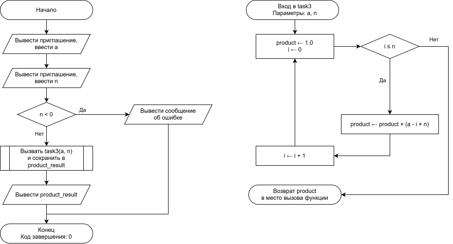

# Домашнее задание

## Условие задачи


---

## 1. Алгоритм и блок-схема

### Алгоритм
1. Начало функции. Получение вещественного числа a и целого числа n в качестве параметров.
2. Инициализировать переменную произведения значением единицы: product = 1.0.
3. Начать цикл for с управляющей переменной i от 0 до n включительно с шагом 1.
4. На каждой итерации цикла умножать текущее значение product на величину (a - i * n).
5. По завершении работы цикла передать накопленное значение product обратно в main с помощью оператора return.
6. Конец функции.

### Блок-схема

[]()
## 2. Реализация программы
```c
printf("Введите a: ");
scanf("%lf", &a_val);
printf("Введите число n: ");
if (scanf("%d", &n_task3) == 1 && n_task3 >= 0)
{
    double product_result = task3(a_val, n_task3);
    printf("Значение выражения: %.4f\n", product_result);
}

double task3(double a, int n)
{
    double product = 1.0;
    for (int i = 0; i <= n; i++)
    {
        product *= (a - i * n);
    }
    return product;
}
```
## 3. Результат работы программы
Ввод: 5.5 2
Вывод: Значение выражения: 28.8750
## 4. Информация о разработчике
Гаврилова Анна, бИД-262
